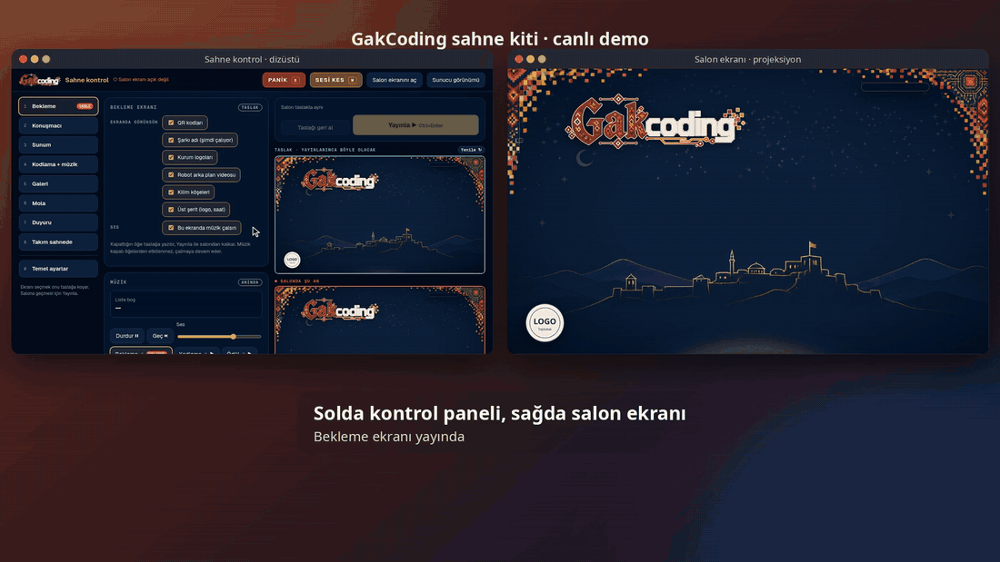

# GakCoding sahne kiti

Bir günlük bir kodlama yarışması (hackathon) için yazılmış sahne yönetim kiti: dizüstündeki **kontrol paneli** salondaki **projeksiyon ekranını** canlı yönetir. Bekleme ekranı, konuşmacı, sunum, kura çarkı, kodlama geri sayımı ve müzik, galeri, mola, duyuru ve kazanan takım ekranları burada.



> **Bu bir ürün değil, tek bir etkinlik için yazılmış bir referans uygulamasıdır.**
> Etkinliğin adı, renkleri, ekran akışı ve metinleri koda gömülüdür. Olduğu gibi kullanılmaz. **Fork'layıp kendi etkinliğinize göre uyarlamanız gerekir.** Aşağıdaki "Uyarlama" bölümü nereleri değiştirmeniz gerektiğini gösterir.

## Nasıl çalışır

```
 dizüstü (tek tarayıcı)                              projeksiyon
┌──────────────────────┐   BroadcastChannel     ┌──────────────────────┐
│ kontrol.html         │ ── 'gak-sahne' ──────▶ │ ekran.html           │
│  ekran seç → taslak  │   + localStorage       │  canlı durumu çizer  │
│  Yayınla → canlı     │   (gak-sahne-v1)       │  (deste iframe'de)   │
└──────────────────────┘                        └──────────────────────┘
          │  /api/coz, /api/listeler, /api/yukle
          ▼
   yerel-sunucu.py (python, sunucu gerekmez; sadece dosya + birkaç uç)

 telefonlar ──▶ sahne-sunucu (Cloudflare Worker + D1): şarkı isteği, fotoğraf galerisi, jüri oylaması
```

- **Taslak / canlı:** Panelde ekran seçmek onu taslağa koyar, sağdaki önizlemede görünür. **Yayınla** (Ctrl+Enter) salona gönderir. Yanlış tıklama salona yansımaz.
- **Panik (B)** salon ekranını karartır, **Sesi kes (M)** müziği susturur.
- **Sunum ekranı** `deste/index.html` destesini salon ekranının içinde açar. Sunucu görünümü konuşmacı notlarını gösterir, kura çarkı da destenin bir slaydıdır (`deste/kura.js`).
- Sunucuya ihtiyaç yoktur: her şey aynı tarayıcıdaki iki pencere arasında konuşur. Telefondan şarkı isteme ve fotoğraf gönderme isterseniz `sahne-sunucu/` klasörünü Cloudflare'e yayınlarsınız.

## Çalıştırma

```sh
cd sahne-ekranlari
./baslat.sh            # ya da: python3 yerel-sunucu.py 8765
```

- Kontrol paneli: `http://localhost:8765/sahne-ekranlari/kontrol.html`
- Salon ekranı: panelde **Salon ekranını aç**. Pencereyi projeksiyona sürükleyin, **F** ile tam ekran yapın.

Telefon tarafı isteğe bağlıdır:

```sh
cd sahne-sunucu
./yayinla.sh yerel     # yerelde dene: http://127.0.0.1:8787
./yayinla.sh           # Cloudflare'e kur (ücretsiz katman yeter)
```

Çıkan adresi ve yönetici şifresini paneldeki **Telefondan gelenler** bölümüne girin.

## Klasörler

| Klasör | Ne |
|---|---|
| `sahne-ekranlari/` | Kontrol paneli, salon ekranı, yerel sunucu, müzik listeleri |
| `deste/` | Örnek sunum destesi (motor + stiller) ve kura çarkı |
| `sahne-sunucu/` | Telefon sayfası, galeri ve jüri için Cloudflare Worker + D1 |
| `juri/` | Jüri oylama şeması üreticisi (Excel ve yazdırılabilir form) |
| `giris-videosu/` | Bekleme ekranındaki robot döngü videosunun kaynağı |
| `salon-krokisi/` | Sürüklenebilir masa yerleşimi |
| `araclar/demo_kayit.py` | Yukarıdaki GIF'i üreten kayıt betiği |

## Uyarlama

Kendi etkinliğiniz için en az şunları değiştirin:

1. **Etkinlik bilgisi:** `sahne-ekranlari/ortak.js` içinde `ETKINLIK` (ad, tarih, yer) ve `SAHNELER` (ekran listesi).
2. **Görseller:** `sahne-ekranlari/assets/` (logo, arka plan, kilim köşeleri) ve `sahne-sunucu/public/*.webp`. Buradaki GakCoding görselleri bu etkinliğe aittir, kendi görsellerinizle değiştirin. Kurum ve sponsor logoları depoda yoktur: `assets/pankart/logo-ornek.webp` ve panik posteri (`assets/pankart/poster.webp`) yer tutucu içerir. Bekleme ekranının arka plan videosu da depoda yoktur; kendi döngü videonuzu `assets/giris/robot-dongu.mp4` adıyla koyun, yoksa durağan arka plan görünür.
3. **Takımlar ve konular:** `deste/kura.js` başındaki `TAKIM` ve `KONU`, `juri/uret.py` içindeki `T` listesi. Buradaki adlar uydurmadır.
4. **Sunum:** `deste/index.html` içine kendi konuşmanızı yazın. Her `<section class="slide">` bir slayttır.
5. **Müzik:** `sahne-ekranlari/muzik-listeleri.json` (YouTube kimlikleri) ya da paneldeki liste düzenleyici.
6. **Telefon sayfasının izin metni:** `sahne-sunucu/public/index.html`. Fotoğraf paylaşım izni ve KVKK metnini kendi topluluğunuza göre yazın.
7. **Cloudflare:** `sahne-sunucu/wrangler.jsonc` içinde alan adı (`routes`) ve isterseniz Turnstile site anahtarı. Gizli anahtarlar `wrangler secret put` ile verilir, depoya girmez.

## Lisans

Kod MIT lisanslıdır (`LICENSE`). GakCoding adı, logosu ve `assets/` altındaki etkinlik görselleri lisansa dahil değildir: fork'unuzda kendi görsellerinizi kullanın.
